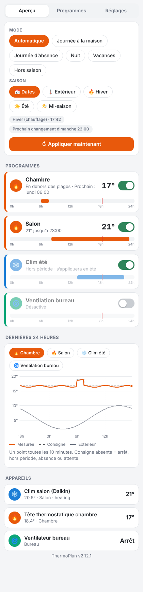
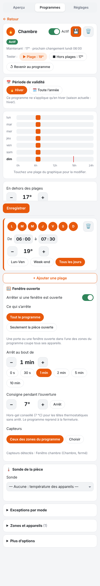
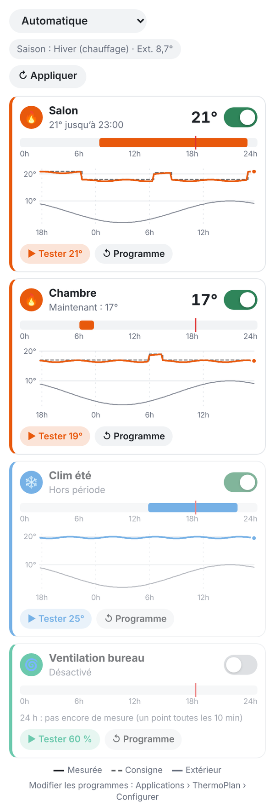

# ThermoPlan (Homey, SDK 3)

[](https://github.com/chrisdecagnes/ThermoPlan/actions/workflows/ci.yml)


[](LICENSE)

Chauffage, climatisation et ventilation programmés pour Homey Pro : plages horaires, saisons (dates ou température extérieure), fenêtre ouverte, sonde de pièce, absence, widget de tableau de bord. Langues : français, anglais, néerlandais, allemand.

<p align="center">
  
  
  
</p>

Réécriture en JavaScript (SDK 3) de [homey-heating](https://github.com/mskg/homey-heating) de Markus Kling (GPL-3.0),
traduite en français et étendue à la **climatisation** et aux **ventilateurs**.

Logo : cycle des saisons (flèche chaude / flèche froide) autour d'un thermomètre — `assets/icon.svg` (monochrome, recoloré par Homey) ; images du store générées par `scripts/render-images.js`.

## Fonctionnalités

| | Chauffage | Climatisation | Ventilation |
|---|---|---|---|
| Consigne | `target_temperature` | `onoff` → marche, `thermostat_mode` → `cool` (ou `cooling`, `froid`… selon la marque, ex. Daikin), `target_temperature` | `onoff`, vitesse via `dim` ou `fan_speed*` |
| « Arrêt » dans le programme | – | `onoff=false` (ou `thermostat_mode=off`) | vitesse 0 → `onoff=false` |
| Saison active | hiver | été | été (ou toute l'année) |
| Hors saison | exception « Hors saison » | extinction (désactivable) | extinction (désactivable) |
| Conflit (plusieurs plans) | max (réglable) | min (réglable) | vitesse max |

- **Saison** (page de réglages ou carte Flow « Changer la saison ») :
  - *Automatique (selon les dates)* : été = 01/06 → 15/09 par défaut ;
  - *Selon la température extérieure* (v2.1) : une sonde choisie dans les réglages (station météo, capteur de jardin, app météo…) est relevée chaque minute ; la saison suit sa **moyenne glissante** (24 h par défaut, 1 à 72 h) : été si la moyenne atteint 22 °C, hiver si elle descend à 15 °C, **mi-saison** (aucun pilotage) entre les deux. Hystérésis de 1 °C contre les bascules répétées. Sans sonde ou sans mesure, repli sur les dates. L'historique (moyennes horaires, 72 h max) est sauvegardé une fois par heure et survit aux redémarrages ; il repart de zéro si l'on change de sonde. Jeton Flow « Température extérieure moyenne ». La sonde peut être une sous-capacité, par exemple la température extérieure mesurée par un climatiseur Daikin (`measure_temperature.outdoorTemperature`), proposée en tête de liste.
  - ou forcée *Hiver* / *Été* / *Mi-saison*.
- **Éditeur en plages horaires** (v2.2) : graphique de la semaine (lun → dim, trait rouge = maintenant, touche = aller à la plage), une valeur « hors plages » (ex. 17 °C, Arrêt) et des plages *jours + de/à + valeur* avec raccourcis Lun–Ven / Week-end / Tous les jours. Une plage dont la fin précède le début déborde sur le lendemain ; en cas de chevauchement, la plage la plus basse gagne (signalé). Boutons **Tester** (envoi immédiat de la valeur aux appareils) et **Revenir au programme**. Les plages (`slots`, `base`) sont enregistrées dans le programme et converties en points de consigne par `settings/slots.js`, partagé entre l'interface et l'application ; les anciens programmes sont convertis sans perte à l'ouverture.
- **Widget de tableau de bord** (v2.3, `widgets/thermoplan/`) : mode (modifiable), saison et température extérieure ; pour chaque programme (ou un seul, choisi dans les réglages du widget) la valeur actuelle, « 20,5° jusqu'à 22:30 », les plages du jour avec le trait « maintenant », un interrupteur Actif et les boutons Tester / Revenir au programme ; mise à jour en temps réel (`homey.api.realtime('thermoplan.state')`) et chaque minute. Homey ne permet pas à un widget d'ouvrir la page de réglages d'une app : le widget l'indique (Applications › ThermoPlan › Configurer). Les widgets imposent `compatibility >=12.3.0` (Homey Pro 2023 et plus récent).
- **Fenêtre ouverte** (v2.4, `lib/windows.js`) : option par programme de chauffage / climatisation. Capteurs d'ouverture (`alarm_contact`) de la zone de chaque appareil, ou capteurs choisis ; arrêt quand l'un d'eux reste ouvert au moins *x* secondes (0 s à 1 h, 60 s par défaut). Portée (v2.8.1) : *tout le programme* (défaut : une ouverture dans l'une des zones sélectionnées du programme ou des zones de ses appareils coupe tous ses appareils) ou *seulement la pièce ouverte*. Chauffage → consigne réglable (hors-gel 7 °C par défaut, ou Arrêt) ; climatisation → arrêt. À la fermeture, la consigne du programme revient. La fenêtre l'emporte sur les conflits entre programmes ; notification « Fenêtre ouverte / fermée » (désactivable) ; état visible dans l'aperçu, l'éditeur et le widget.
- **Sonde de la pièce** (v2.5, `lib/room.js`) : par programme, une sonde de température (y compris une sous-capacité). Mode *Affichage* : sa mesure remplace la moyenne des appareils (aperçu, widget, thermostat virtuel). Mode *Régulation par ThermoPlan* (chauffage / clim) : demande sous « consigne − marge » (chauffage) ou au-dessus de « consigne + marge » (clim), attente de l'autre côté, état conservé entre les deux ; attente = arrêt (`onoff`) si possible, sinon 7 °C en chauffage. Marge ±0,1 à ±3 °C (0,5 par défaut). Sans mesure, le programme s'applique normalement. Les appareils éteints par ThermoPlan (attente, fenêtre) sont rallumés quand la consigne revient.
- **Ventilation de la clim par plage** (v2.6) : chaque plage d'un programme de chauffage / climatisation peut fixer la ventilation du climatiseur : inchangée (défaut), Auto, Silence ou un niveau (1…N, N lu sur l'appareil). Détection générique des capacités « vitesse » (`fan_speed`, `fan_mode.speed`, `*level*`…) et « mode » (`fan_mode`, `fan_mode.mode`, `thermostat_fan_mode`…) ; valeurs reconnues par motif (auto, quiet/silence/night, manual/fixed). Un niveau fixe sort d'abord du mode auto/silence si le mode est séparé (cas Daikin).
- **Ventilateurs** (v2.7) : si le ventilateur a des vitesses par niveaux (`fan_speed` low/medium/high…) l'éditeur propose Arrêt, 1…N, Auto, Silence (selon ce que l'appareil sait faire) ; sinon un curseur en % (`dim`), avec Auto / Silence si disponibles. Valeur `{ fanSpeed, fan? }` ; niveau k/N → k-ième valeur ; « Silence » sans valeur dédiée = vitesse minimale.
- **Ventilation selon la température** (v2.9, `lib/room.js`) : un programme de ventilation avec une sonde de pièce en mode « Selon la température » ne tourne (à la vitesse de la plage) que lorsque la pièce dépasse *seuil + marge* (26 °C ± 0,5 par défaut, seuil de 15 à 40 °C) et s'arrête sous *seuil − marge*. Une plage à l'arrêt reste à l'arrêt. Déclencheur Flow « La température extérieure moyenne a changé » (jetons moyenne / précédente, arrondi 0,5 °C).
- **Personne à la maison** (v2.8, `lib/presence.js`) : réglage global. Quand tous les utilisateurs Homey ayant la présence activée sont absents depuis *x* minutes (15 par défaut, 0 à 240), toutes les programmations de saison passent en pause : chauffage arrêté (hors-gel 7 °C pour les têtes sans arrêt) ou réduit (16 °C par défaut), climatisation et ventilation arrêtées. Reprise immédiate au retour de quelqu'un. Carte Flow « Absence : automatique / personne à la maison / quelqu'un est à la maison », condition « en pause », déclencheurs pause / reprise, notification (désactivable).
- **Modes** (repris de l'original) : Automatique, Journée à la maison, Journée d'absence, Nuit, Vacances, Hors saison. Les trois premiers reviennent en Automatique à minuit.
- **Thermostat virtuel** par programme de chauffage / climatisation : consigne manuelle jusqu'à minuit ou en permanence.
- **Fuseau horaire** : le SDK 3 tourne en UTC, les programmes sont évalués dans le fuseau du Homey.
- **Écritures minimales** : évaluation chaque minute, écriture uniquement quand l'état calculé d'un programme change, et seulement si la valeur de l'appareil diffère. Un réglage manuel fait sur un thermostat est conservé jusqu'au point de consigne suivant. 3 tentatives en cas d'échec.
- **Sauvegarde/restauration** JSON, compatible avec les sauvegardes de l'application d'origine (programmes importés comme « chauffage »).

## Arborescence

```
app.js                    application (initialisation, cartes Flow, jetons, API)
api.js                    routes de l'API Web utilisées par la page de réglages
lib/model.js              constantes (types, modes, saisons, réglages)
lib/time.js               fuseau horaire, minutes de la semaine, intervalles de dates
lib/calculator.js         calcul pur des consignes (testé)
lib/presence.js           absence de tous (présence Homey, forçage par Flow)
lib/room.js               sonde de la pièce (affichage, régulation avec marge)
lib/windows.js            arrêt sur fenêtre ouverte (capteurs, délai)
lib/outdoor.js            saison selon la température extérieure (moyenne glissante, hystérésis)
lib/repository.js         stockage + validation des programmes
lib/devices.js            accès aux appareils Homey (homey-api), sondes, pilotage
lib/controller.js         ordonnanceur, modes, saisons, conflits, notifications
drivers/virtual-thermostat/   thermostat virtuel
widgets/thermoplan/       widget de tableau de bord (page, API, aperçus clair/sombre)
settings/                 page de réglages (HTML/JS sans dépendance) ; settings/slots.js = calcul des plages (partagé)
locales/fr.json, en.json, nl.json, de.json  traductions (générées par scripts/locales-src.py ; nl/de depuis scripts/i18n-nl-de.json)
.homeycompose/            source de app.json (généré par scripts/compose-src.py)
test/                     tests unitaires (node --test)
bench/                    banc d'essai : Homey simulé + vraie classe App (sim.js), serveur des pages (server.js), vérification Chromium et aperçus du widget (check.js) — exclu du paquet
```

## Développement

```bash
npm install                  # homey-api (seule dépendance de l’app)
npm install -g homey         # CLI Homey
npm test                     # 60 tests (unitaires + démarrage de app.js sur un Homey simulé)
npm run compose              # régénère .homeycompose, locales et app.json
npm run check-ui             # réglages + widget sous Chromium (fr/en/nl/de), captures dans bench/out (nécessite playwright)
npm run previews             # régénère widgets/thermoplan/preview-light.png / preview-dark.png (1024×1024)
npm run bench                # http://localhost:8123/settings/ et /widget/ avec des appareils de démonstration
npm run images               # images du store (app et thermostat virtuel)
homey login
homey app run                # exécution sur votre Homey Pro, logs en direct
homey app validate --level publish
homey app publish            # envoi vers le Homey App Store (Athom valide ensuite)
```

`DRY_RUN=1` dans `env.json` → l'application calcule tout mais n'écrit rien sur les appareils.

## Avant publication

1. **Identifiant** : `fr.cpistre.thermoplan`, unique sur le store (à ne plus changer une fois publié).
2. **Dépôt source** : https://github.com/chrisdecagnes/ThermoPlan (public : obligatoire pour une app GPL dérivée).
3. Tester sur un vrai Homey Pro (2023) avec vos thermostats, climatiseurs, ventilateurs et une sonde extérieure ; vérifier que `homey app validate --level publish` passe.
4. Licence : l'application d'origine est sous GPL-3.0, cette réécriture dérivée reste sous GPL-3.0 et crédite l'auteur original (README.txt et `contributors`).

La marche à suivre complète (GitHub Desktop puis Homey App Store) est dans [docs/PUBLICATION.md](docs/PUBLICATION.md).
